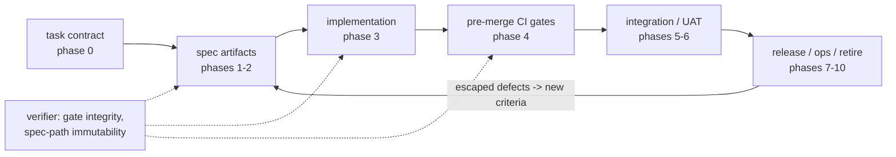

# Architecture - sdlc_development_kit

## Intent
An SDLC gate architecture for automated LLM development: spec-first gates plus static enforcement, so agent-written code cannot degrade the codebase and bug classes close at the earliest decidable point.

## Invariants
Full wording, success criteria and non-goals: [docs/theory.md](docs/theory.md).
- **Spec-first gates**: authored before and apart from the implementation, mechanically checked, immutable to the implementer.
- **Two channels**: spec and implementation come from separate agents with decorrelated context.
- **A gate** is a human judgment made a text artifact plus a mechanical check, with diagnostics an agent can loop on.
- **Earliest decidable point**: cost sets cadence, never rigor.
- **Detectability ladder**: push bug classes up it; do not pile detectors at the bottom.
- **The enforcement layer** is the highest-privilege artifact set, with its own approval channel and regression suite.
- **Convergence**: each escaped defect becomes a new immutable criterion.
- **Explicit retirement**: a deprecation phase is mandatory.
- **Specs stay declarative**, so spec review stays cheap.

## Diagram

## Folder map
| Folder | Purpose |
|---|---|
| [skills/](skills/) | The `sdlc` skill and the interview skill |
| [hooks/](hooks/) | The plugin's hooks: the session-size message; the execution team's wall (`wall.py`), which refuses a tool call across `.sdlc/config.yaml`'s `wall:` while a task runs |
| [taskcontract/](taskcontract/) | The validator and work tree (pip package) |
| [workflows/](workflows/) | The execution team's scripts: `tools/task.py` starts a task; `tools/prove.py` and `tools/receipts.py` run the declared test command |
| [specs/](specs/) | Task contracts and the vocabulary |
| [agents/](agents/) | Two-Key personas: developer, verifier |
| [docs/](docs/) | Gates, taxonomy, features, conventions, USAGE's pages |
| [decisions/](decisions/) | ADRs, append-only |
| [tests/](tests/) | The regression suite |

## Where things live
| Kind of fact | Home |
|---|---|
| Use and install | [README.md](README.md), [USAGE.md](USAGE.md) (an index of [docs/usage/](docs/usage/)) |
| Intent, invariants, folders | This file |
| What each piece does | [docs/components.md](docs/components.md) |
| How work is done | [CONTRIBUTING.md](CONTRIBUTING.md) |
| A decision | Its ADR in [decisions/](decisions/) |
| Backlog, open questions | [docs/backlog.md](docs/backlog.md) |
| Releases | [CHANGELOG.md](CHANGELOG.md) |
| This machine | `CLAUDE.local.md` (untracked) |
